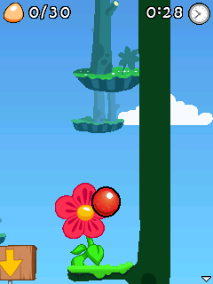

# PS3ME compatibility audit — 01.16

## Baselines and scope

Implementation baseline: the supplied **01.15 source archive**, with newer
GitHub documentation retained. GitHub main was still an 01.14 implementation.
The 01.15 loading/scaling changes are included, not replaced by the older tree.

Original PS2ME: [Wellinator/PS2ME v1.4.0](https://github.com/Wellinator/PS2ME/tree/98dd9ff0b134e2aa13a752c7e6ce034283c0d2a5),
commit `98dd9ff0b134e2aa13a752c7e6ce034283c0d2a5`. Its upstream `ps2` tree was
compared by actual file contents: **131 identical, two changed, zero absent**
against PS3ME's preserved import. The changed LCD/event-queue files are existing
port adaptations. Preserved source files alone do not prove a feature is built.
The audit also follows the upstream build scripts, phoneME overlays, Java class
injection, native bindings and final package composition.

The runtime baseline has 748 classfiles. The new runtime has **758**, including
the replacements for existing Manager/AudioPlayer classes. All **356 native
method declarations** were matched to symbols in the final debug ELF, including
the VM's eight special Math/String intrinsic mappings. This proves symbol
availability, not correctness of every native method.

The machine-readable reports are in `build/validation/compatibility_0115_baseline.json`,
`compatibility_0116.json`, and `native_declarations_0116.json` in the source ZIP.
`tools/audit_compatibility.py` reproduces class/member resolution and source
inventories. Its inheritance search includes superclasses and interfaces; it
does not infer correctness from matching names.

This is a source and packaging audit with targeted execution tests. It is not
an exhaustive runtime test of every Java ME API, all JARs, all firmware or all
PS3 hardware. Unsupported behavior and remaining limits are listed below.

## Bounce Tales: cause and evidence

Supplied JAR SHA-256:
`189a94ec23c79c12c29b0355f6894bdd699f0f52958d7446feeef0bd1a7e6b3f`.
The JAR contains 19 classfiles and MIDI resources. Its bytes were not patched.

| Required reference | 01.15 packaged runtime | 01.16 |
|---|---|---|
| `DeviceControl.setLights(II)V` | Class absent | Resolves |
| `DirectUtils.getDirectGraphics(Graphics)` | Class absent | Resolves |
| `DirectGraphics.fillPolygon(...)` | Class absent | Resolves |
| All other static game class/member references | Resolve | Resolve |

Bytecode inspection shows `o.b(boolean)` directly invoking setLights. Rendering
paths in `j` also obtain DirectGraphics and fill polygons. Upstream's
`build-midp-ps2.sh` includes the Nokia sources in `APP_JAVA` and romizes them as
platform classes. PS3ME's `inject_bootloader.py` previously injected only its
GameLoader. The sources existed in the import but their classfiles never reached
`classes.zip`. The fix packages the platform APIs generally; it does not branch
on the game name, checksum, obfuscated class names or loading state.

RPCS3 observations with the missing APIs restored:

- The Java raster reached the New game / High scores / Instructions menu.
- Scripted Fire presses selected Chapter 1 and advanced its opening dialogue.
- Subsequent captures show active gameplay, an advancing timer, a jumping ball
  and camera movement. This is more than a first-frame/loading-bar observation.
- No uncaught game exception was observed during those runs.

The captures were taken directly from the emulated application's RGB565 raster,
using an optional native developer replay harness. RPCS3 used the Null renderer;
this does **not** validate RSX/OpenGL presentation or physical pad input. The
harness is compiled out of the release executable. The final release executable
is tested separately with the compatibility MIDlet.

No class-lookup cache size change was needed to clear this blocker. The static
dependency comparison and observed progression identify missing packaged APIs;
there is no evidence here that an undersized lookup cache caused this freeze.
01.15's archive caching remains intact, but it cannot supply absent classes.



## Source-level findings and disposition

| Component | Finding / classification | Implementation or decision |
|---|---|---|
| CLDC/MIDP core | Retained phoneME interpreter and library; existing native-width migration | Preserve interpreter, class initialization, exception machinery, GC, array/stack maps and monitor changes. Host tests exercise arithmetic, interfaces, GC roots, exceptions, arraycopy, threads and sleep. |
| Nokia FullCanvas / DeviceControl / DirectUtils / DirectGraphics | Accidentally omitted from runtime packaging | Restore five UI classfiles, including the implementation class. Backlight/vibration remain safe console no-ops, as upstream. |
| Nokia Sound / SoundListener | Omitted; original Sound depends on PS2 SPU2 natives | Supply Sound and SoundListener with MIDI/WAV-backed playback, volume, looping, stop/release/state/listener handling. Tone/OTA conversion uses the existing audio engine. |
| AudioClip / ToneClip / OtaClip / WavClip | Package-private PS2 implementation helpers | Replaced by the PS3 Sound adapter and bounded converter; do not add duplicate SPU2-facing classes. |
| MMAPI stream playback | Intentionally replaced and already working | Preserve the existing AudioPlayer/native backend, MP3 worker, PCM budgets, MIDI synth and WAV mixing. |
| MMAPI playTone / ToneControl | Useful upstream behavior was lost | Restore playTone, tone device, sequence streams, notes, silence, tempo, resolution, volume, named blocks and repeats. Validate malformed/recursive sequences before playback. |
| Graphics.drawImage self-blit | Portable upstream compatibility patch missing | Restore no-op for identical source/destination, consistent with upstream and the MIDP undefined-result allowance; keep anchor checks. |
| Raster fill alignment | Original PS2 applied a safe-store workaround; PPU still had a four-byte alignment assumption before jlong writes | Improve the fast path to align fully to eight bytes. Do not copy the MIPS-only disable-fast-path guard. Test the real routines with all 0/2/4/6 offsets and odd row widths. |
| Canvas / GameCanvas / Sprite / TiledLayer | Standard phoneME Java and native implementations present | Retain; Bounce exercises GameCanvas/graphics and the game loop. No class-name-only replacement. |
| Controller / touchscreen / profiles | Already have PS3-specific implementations | Preserve routing, duplicate-key handling, deadzone, pen lifecycle, resolutions, profile persistence and in-game menu. |
| RMS / suite storage | PS2 uses RAMFS snapshots to memory card; PS3 uses POSIX disk storage | Retain persistent per-game appdb; do not transplant rmfs snapshots or PS2 memory-card code. |
| javaTask teardown | PS2-specific launcher entry has extra finalization | PS3 enters via MidpRuntime and already calls audio shutdown then midpFinalize after execution. Do not replace it with the PS2 JavaTask loop. |
| JAR/resource access | 01.15 has bounded shared native snapshots plus existing inflater/CRC fixes | Keep both cache and stdio fallback, session retirement, write bypass, CRC validation and native-width handles. |
| Timers / threads / events | Existing cooperative PS3 timer/VM poll adapters replace PS2 alarms | Preserve cancellation/reuse protection and callbacks. Java green threads run through the existing VM scheduler, not new PPU threads per Java Thread. |
| OS / memory / clock / cache | PPU adapters already replace MIPS/PS2 services | Retain PSL1GHT allocation/time/filesystem/cache adapters. No PS2 syscall, DMA, SIF, audsrv or GS code copied. |
| Tail-threaded dispatch | Upstream optional optimization, disabled by default | Not enabled blindly on PPU: tail-call ABI, stack growth and measured game performance need separate validation. |
| Global interpreter registers | Upstream MIPS-specific optimization | Do not copy fixed MIPS register assignments into the PowerPC ABI. |
| Profiling counters | Optional upstream instrumentation | Developer replay/capture and diagnostics are available; do not add bytecode/frame profiling overhead to the release. |
| Siemens/Motorola/Sony Ericsson extensions | Not supplied by this upstream PS2ME API layer | Not an accidentally deleted port feature. Not added speculatively. J2ME Loader/FreeJ2ME's larger extension sets remain future compatibility work. |

## Remaining unsupported or incomplete behavior

- **DirectGraphics** inherits upstream limits: getPixels readback is a no-op,
  polygon filling is a triangle fan intended for convex polygons, sub-byte gray
  formats are approximate, some manipulation combinations fall back to no
  transform, and alpha on standard Graphics primitives is not fully supported.
  DirectUtils' mutable ARGB image creation cannot retain transparent backing
  pixels using its current MIDP implementation. These need graphics/image
  implementation work and pixel tests; this release does not label them complete.
- **Nokia OTA melodies** retain upstream's basic/temporary-song subset. Reuse of
  earlier OTA patterns and embedded pattern loop counts are not implemented.
  The Sound-level repeat count works. ToneControl blocks/repeats are separately
  supported. Very large or malformed input is rejected rather than silently
  decoding indefinitely. Pure-tone pitch outside the MIDI note/bend range is
  limited by that backend; Nokia phone-tone output is not waveform-identical.
- **Networking** remains disabled: PCSL uses `NETWORK_MODULE=stubs` and the VM
  socket adapter yields instead of providing sockets. HTTP/socket APIs being
  named in the class library does not make the transport work. A real port needs
  asynchronous PS3 networking, scheduler integration and security validation.
- **JSR-75 FileConnection** is not present as a working public extension. Internal
  JavaCall/PCSL filesystem access and RMS do not imply FileConnection support.
- **MMAPI** remains an audio subset. General URI/file/network locators, media
  time/duration reporting and arbitrary seeking, camera, video, recording and
  broader codec/control APIs are not fully implemented. MP3/MIDI/WAV and the
  restored tone paths use the existing backend. No AMR/AAC/video support is implied.
- **Manufacturer/optional JSR APIs** such as Siemens/Motorola/Sony Ericsson,
  M3G, Bluetooth, messaging, sensors, location and proprietary 3D are not
  automatically provided by this port. These are substantial separate projects,
  not missing source files recovered by this comparison.
- **Optional platform services** still return NOT_IMPLEMENTED for serial,
  annunciators, rumble/backlight and dynamic permission callbacks. Platform font
  failure intentionally activates phoneME's bitmap font fallback; returning
  success without glyphs would make text disappear. Static permission policy is
  used; serial hardware has no matching phone device abstraction here.
- An internal-suite bootstrap can log a caught `SecurityException: no security
  context set` while reading internal JAR properties, before the external suite
  installs and runs. It also occurs in the earlier builds; it is not the Bounce
  missing-class failure. This audit does not claim all security paths correct.
- No SPU acceleration or new JIT is introduced. These would require new code
  partitioning, synchronization, memory/transfer budgets and benchmarking.

## Additional emulator references and licensing

Inspected [FreeJ2ME](https://github.com/hex007/freej2me/tree/eb4ac87e9a0b212ba701691eb67ee4892b2b1173)
and [J2ME Loader](https://github.com/nikita36078/J2ME-Loader/tree/76383ebf348b5d477256fc884dfc55f053b45a86)
for Nokia DeviceControl, DirectUtils/DirectGraphics, pixel formats/transforms,
sound and their broader API inventories. They corroborate that Nokia APIs are
platform classes and that the Android implementation depends on its own bitmap
and graphics backend.

FreeJ2ME is GPL-3.0-or-later. J2ME Loader has Apache-2.0 code and files with
additional dual-license notices. They are **references only** here: no code or
assets from either is incorporated or relicensed into this GPL-2.0-only project.
PS2ME's compatible upstream code and original PS3 adapters retain their notices.

## Validation and limits

| Layer | Evidence |
|---|---|
| Host 32-bit CLDC | 18 VM checks passed through qemu-i386; genuine compiler/preverifier/interpreter execution. |
| Host 64-bit CLDC | Same 18 checks passed on the native-width VM. |
| Host restored APIs | 24 tone/device/converter checks on the 64-bit CLDC VM, including malformed OTA, invalid/reentrant blocks, repeats and timing. |
| Production graphics routines | 419,152 pixel comparisons, ASan/UBSan, widths 1..67, four pointer alignments; no sanitizer failures. |
| Existing controls / JAR / loading | Controls suite and three production JAR-reader tests passed; 200 scaler comparisons plus snapshot lifetime/EOF/overflow/budget/write fallback tests passed with sanitizers. |
| Existing audio | 960 MIDI allocations with slot reuse/repeated shutdown and WAV validation passed with sanitizers; seven MP3 assets from the supplied Nyan/Bolachinha test games passed the 256-KiB-decoder/guarded-16-KiB-playback test. |
| Native build | Changed PPU graphics objects and application compiled; ELF architecture/import/descriptor validation passed. Existing recovered VM/PCSL archives were retained. This is not a fresh build of every dependency. |
| RPCS3 Bounce | Menu, Chapter 1, dialogue and responsive gameplay captured. Test harness uses Null renderer and synthetic input; no full playthrough or physical controller test. |
| RPCS3 release API test | Final release executable runs CompatibilityMIDlet: Nokia tone checks, self-blit/anchor/RGB565/DirectGraphics tests and MMAPI/Nokia playback-state tests. |
| RPCS3 representative smoke tests | Nyan Cat CLDC-fixed JAR and Bolachinha 0.4.2 launched, produced Java frames and processed the synthetic input sequence without an uncaught exception in 30–35 seconds. Bolachinha loaded its MP3 and effects. This is startup smoke coverage, not full gameplay or audible-output validation. |
| Physical PS3 | **Not tested for 01.16.** Trashy12's successful hardware testing applies to earlier versions. |

Audio data reaching the emulated mixer is not an audible-output test. No PS3
loading-speed/FPS multiplier is claimed from host benchmark timings. Game JARs,
firmware and SDK binaries are excluded from the public install and source packages.

## Rebuilding the changed components from the source ZIP

Use the pinned SDK and the included recovered archives/headers. Place the adapted
`vendor/phoneME` tree at `deps/phoneME`, retain the full pinned phoneME tree for
build tools, and provide JDK 8 plus a working CLDC preverifier. On hosts without
an i386 execution ABI, use `tools/run_i386.sh` and qemu-i386 with a suitable sysroot.

```sh
python3 tools/inject_compatibility.py --jdk /path/to/jdk8 --runner /path/to/i386-runner
python3 tools/rebuild_graphics_compatibility.py
python3 tools/build_application.py --reuse-prebuilt-archives
python3 tools/package_application.py --output /path/to/PS3ME_PS3_01.16.pkg --crypto-libs /path/to/libcrypto1.1
python3 tools/package_source.py --output /path/to/PS3ME_PS3_Source_01.16.zip
```

Full MIDP builds call the compatibility injector through inject_bootloader, and
integrate_audio retains the tone dispatch when rebuilding Manager/AudioPlayer.
The release package rejects missing mandatory platform classfiles. The optional
`--runtime-replay` build flag is for developer tests only; rebuild without it
before packaging. Diagnostic sources are included; their JARs are not installed
by the public package.
